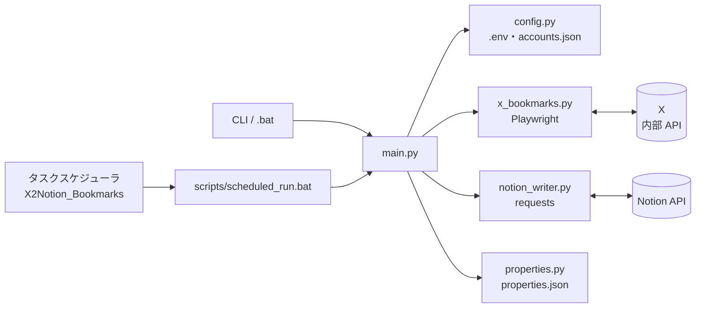
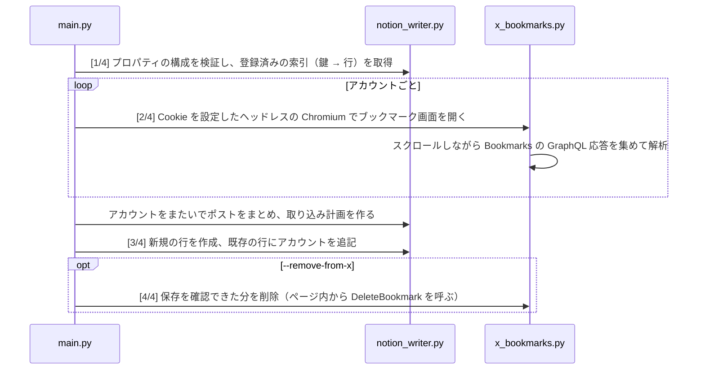

# 設計

## 全体構成

## ディレクトリ構成と各モジュールの責務

| パス | 責務 |
|---|---|
| `src/main.py` | CLI（`setup`、`run`、`migrate`、`schedule`、`properties`）、取り込みの手順、ログ出力、`schtasks` の呼び出し |
| `src/config.py` | `.env` と `accounts.json` の読み込みと検証、定数（Notion API のバージョンなど） |
| `src/x_bookmarks.py` | Playwright によるブックマークの取得（内部 API の応答の解析）、タイトルの要約、ブックマークの削除 |
| `src/notion_writer.py` | Notion API の呼び出し（データベースの作成・検証、登録済みの索引、ページの作成、アカウントの追記）、重複判定の鍵、取り込み計画の作成 |
| `src/properties.py` | プロパティの対応表（`properties.json`）の読み書きと、データベースからの推定 |
| `tools/rebuild_titles.py` | 既存の行のタイトルを作り直す |
| `tests/test_core.py` | 中核ロジックの回帰テスト（外部通信なし） |
| `取り込み実行.bat`、`自動実行を設定.bat`、`自動実行を解除.bat` | ダブルクリック用の入口 |
| `scripts/scheduled_run.bat` | タスクスケジューラから呼ばれる入口（`pythonw.exe` で `run --log --remove-from-x`） |

## データの流れ

`run` の流れ。

- X の取得には時間がかかるため、先に Notion 側の疎通と登録済みデータを確認する。
- 取得は、ブラウザ上でスクロールし、`/i/api/graphql/<id>/Bookmarks` の応答を横取りして解析する（[ADR 0003](adr/0003-read-x-internal-api-via-browser.md)）。
- 削除は、読み込まれた JS バンドルから `DeleteBookmark` の queryId を取り出し、ページ内から呼び出す（Cookie とオリジンをそのまま使うため）。
- 重複判定の鍵はツイート ID（[ADR 0004](adr/0004-dedupe-by-tweet-id.md)）。
- 書き込むプロパティは対応表で決める（[ADR 0005](adr/0005-property-mapping-file.md)）。

## 外部依存

| 依存 | 用途 |
|---|---|
| Playwright（Chromium） | X のブックマーク画面の読み込みと、応答の取得・削除の呼び出し |
| requests | Notion API の呼び出し（API バージョン `2022-06-28`） |
| python-dotenv | `.env` の読み込み |
| X の内部 API（GraphQL） | ブックマークの取得・削除。非公開の仕様 |
| Windows のタスクスケジューラ（`schtasks`） | 自動実行 |
